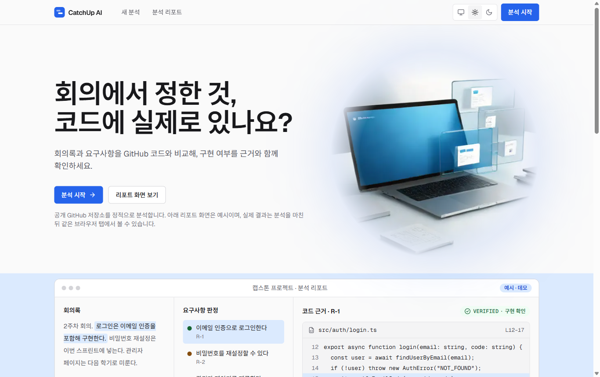
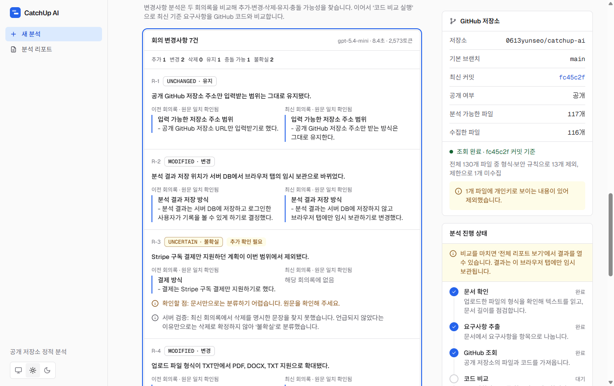
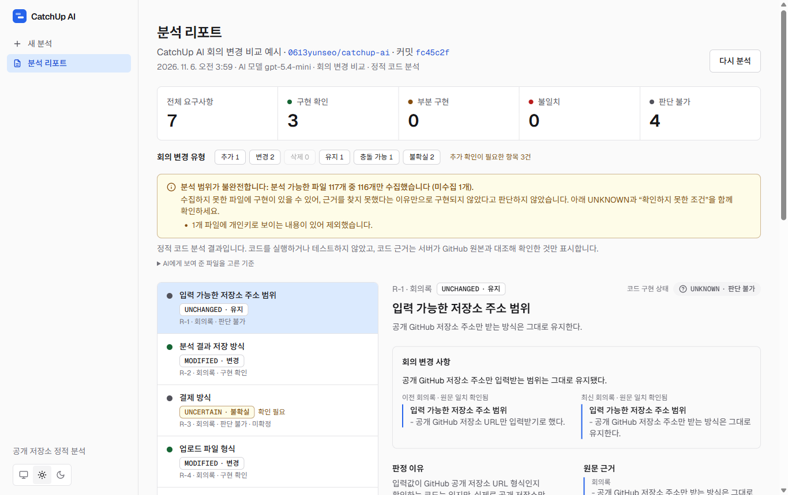
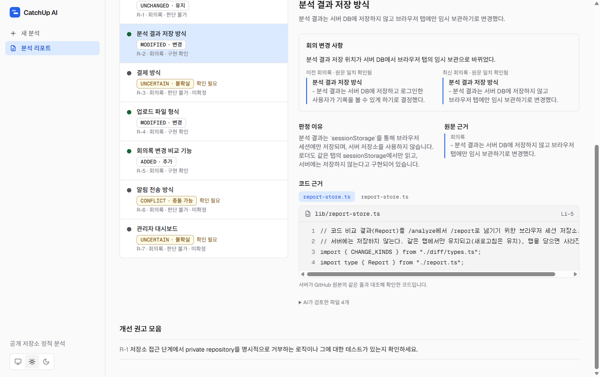

# CatchUp AI

> **회의에서 정한 것, 코드에 실제로 있나요?**

회의록·교수 피드백·요구사항 문서에서 AI로 요구사항을 추출하고, 공개 GitHub 저장소의 **실제 소스코드**와 비교해 구현 여부를 **코드 파일·라인 번호 근거**와 함께 보여주는 웹 서비스입니다. NEXT AI 해커톤 출품작입니다.

| | |
|---|---|
| 배포 사이트 | https://catchup-ai-liart.vercel.app/ |
| GitHub | https://github.com/0613yunseo/catchup-ai |



## 문제 정의

팀 프로젝트에서는 결정이 여러 곳에 흩어집니다. 회의록에는 합의 내용이, 교수 피드백에는 수정 요청이, 별도 문서에는 개발 요구사항이 있습니다. 회의가 거듭될수록 요구사항은 추가되고, 바뀌고, 조용히 사라집니다.

그래서 매번 같은 질문이 남습니다.

- 지난 회의에서 **확정한 것이 실제 코드에 들어갔는가?**
- 교수님이 **지적한 항목이 반영되었는가?**
- 이번 회의록이 **지난 회의록과 무엇이 달라졌고**, 그 변경이 코드에 반영되었는가?

이를 확인하려면 문서를 다시 읽고 저장소를 직접 뒤져야 합니다. CatchUp AI는 이 대조 작업을 자동화하되, **AI의 답을 그대로 믿지 않고 서버가 원문과 코드를 다시 확인**하는 방식으로 만들었습니다.

## 핵심 기능

| 기능 | 설명 | 상태 |
|---|---|---|
| 문서 입력·업로드 | 회의록·교수 피드백·요구사항을 붙여넣거나 PDF·DOCX·TXT 파일(1개)로 올립니다. 텍스트 PDF만 지원하며 OCR은 없습니다. | 구현 |
| AI 요구사항 추출 | 문서에서 요구사항을 항목으로 나눕니다. 원문 인용은 서버가 문서와 대조해 검증합니다. | 구현 |
| 결정 상태 구분 | 각 요구사항을 **확정 / 제안 / 미확정**으로 분류합니다. 제안은 미준수로, 미확정은 구현 여부 판정 대상으로 보지 않습니다. | 구현 |
| 회의 변경사항 탐지 | 이전·최신 회의록을 비교해 `ADDED` `MODIFIED` `REMOVED` `UNCHANGED` `CONFLICT` `UNCERTAIN`으로 분류하고, 최신 기준 요구사항을 코드와 비교합니다. | 구현 |
| 공개 저장소 조회 | 공개 GitHub 저장소의 파일 트리와 소스를 커밋 SHA 기준으로 수집합니다. | 구현 |
| 실제 소스코드 비교 | 수집한 코드를 근거로 요구사항별 구현 여부를 판정합니다. | 구현 |
| 근거 검증 | AI가 제시한 파일 경로·라인·인용 코드를 서버가 GitHub 원본과 대조합니다. | 구현 |
| 분석 리포트 | 판정, 이유, 원문 근거, 코드 근거, 변경 유형, 확인하지 못한 조건을 한 화면에 보여줍니다. | 구현 |

### 서비스 이용 방법

1. `/analyze`에서 **단일 문서 분석** 또는 **회의 변경 비교**를 고릅니다.
2. 프로젝트 이름과 문서를 입력합니다(붙여넣기 또는 파일 업로드). 변경 비교에서는 이전·최신 회의록을 각각 입력합니다.
3. 공개 GitHub 저장소 URL을 넣고 **저장소 확인**을 누릅니다.
4. **분석 시작**(또는 **변경사항 분석**)으로 요구사항을 추출한 뒤 **코드 비교 실행**을 누릅니다.
5. **전체 리포트 보기**에서 `/report` 결과를 확인합니다.

## 서비스 화면

실제 배포 사이트에서 캡처한 화면입니다. 예시 회의록은 이 프로젝트 자체를 대상으로 직접 작성했습니다.

**회의 변경 탐지** — 이전·최신 회의록의 원문 인용이 각각 검증되어 표시됩니다. 아래 R-3은 AI가 삭제로 분류했지만 최신 회의록에 삭제 문장이 없어 서버가 `UNCERTAIN`으로 낮춘 사례입니다.



**분석 리포트** — 변경 유형과 코드 구현 상태가 따로 표시됩니다.



**코드 근거** — 인용된 파일·라인은 서버가 GitHub 원본과 대조한 코드입니다.



## 판정 기준

**구현 상태** (코드 비교 결과)

| 상태 | 의미 |
|---|---|
| `VERIFIED` | 서버가 검증한 코드 근거로 요구사항 구현이 확인됨 |
| `PARTIAL` | 일부 조건만 확인됨 |
| `MISMATCH` | 확정된 요구사항과 코드가 어긋나는 근거가 확인됨 |
| `UNKNOWN` | 검증된 근거가 부족하거나, 확정되지 않은 요구사항이라 판정하지 않음 |

**변경 유형** (회의 변경 비교 결과, 구현 상태와 별개의 필드)

| 유형 | 의미 |
|---|---|
| `ADDED` | 최신 회의록에서 새로 생김 |
| `MODIFIED` | 두 회의록에 모두 있고 의미가 실제로 달라짐 |
| `REMOVED` | 최신 회의록이 삭제를 **명시적으로 확정**함 |
| `UNCHANGED` | 의미가 같음(표현만 다른 경우 포함) |
| `CONFLICT` | 서로 맞지 않는데 최종 결정을 문서만으로 알 수 없음 |
| `UNCERTAIN` | 근거가 부족하거나 모호함 |

## AI 신뢰성 확보 방식

AI는 후보를 제안하고, **결과로 인정할지는 서버가 정합니다.** 모든 모델 호출은 JSON Schema 기반 Structured Outputs(`strict`)를 쓰고, 응답을 받은 뒤 서버가 다시 검증합니다.

**원문 인용 검증** (`lib/extract`, `lib/diff`)
- AI가 가져온 `sourceQuote`가 입력 문서에 그대로 있는지 확인합니다(공백·줄바꿈 차이만 허용). 요약·번역·부분 수정은 통과하지 못합니다.
- 요구사항 추출에서 검증에 실패한 응답은 고쳐 쓰지 않고, 문제점을 알려 주며 **한 번만** 다시 요청합니다. 계속 틀리면 결과를 쓰지 않고 오류로 처리합니다.
- 변경 탐지는 항목 단위로 처리합니다. 원문과 다른 인용은 **화면에 쓰지 않고**, 그 쪽 근거를 잃은 항목은 `UNCERTAIN`(추가 확인 필요)으로 낮추며, 근거가 하나도 없는 항목은 결과에서 빼고 제외한 건수를 화면에 표시합니다.

**코드 근거 검증** (`lib/compare/evidence.ts`)
- 코드는 클라이언트가 보낸 것을 쓰지 않고, 서버가 같은 **커밋 SHA로 고정해 GitHub에서 직접 수집**합니다.
- AI가 제시한 경로가 실제로 AI에게 보여준 파일인지, 줄 범위가 유효한지, 인용 코드가 그 줄 안에 있는지 확인합니다. 줄 번호가 한두 줄 어긋난 경우에만 인용 코드가 실제로 발견되는 위치로 보정하고, 보정했다는 사실을 화면에 표시합니다.
- 화면의 코드 스니펫은 AI가 쓴 글이 아니라 서버가 원본에서 잘라낸 코드입니다.

**서버 정책** (`lib/compare/policy.ts`, `lib/diff/schema.ts`)
- 검증된 근거가 없으면 `UNKNOWN`입니다. 근거를 찾지 못했다는 이유만으로 `MISMATCH`로 단정하지 않습니다.
- 미확정 요구사항은 모델을 호출하지 않고 `UNKNOWN`으로 둡니다. 제안은 `MISMATCH`로 판정하지 않습니다.
- README·`package.json`만 근거인 경우 `VERIFIED`가 될 수 없습니다.
- **주석·`import`·괄호만 있는 줄**은 구현 근거로 세지 않습니다(서버가 근거 줄의 내용을 직접 확인). 근거가 그런 줄뿐이면 `VERIFIED`·`PARTIAL`은 `UNKNOWN`으로 낮아집니다.
- AI는 근거마다 `direct`(핵심 동작을 직접 수행) / `partial`(일부 조건) / `context`(배경·참고)를 표시합니다. `VERIFIED`에는 `direct` 근거가 필요하고, `partial`뿐이면 `PARTIAL`, `context`뿐이면 `UNKNOWN`으로 낮춥니다. AI가 확인하지 못한 조건을 밝혔다면 `VERIFIED`가 아니라 `PARTIAL`입니다. `MISMATCH`도 충돌을 직접 보여 주는 근거가 있어야 합니다.
- 일부 파일을 수집하지 못한 경우 범위 불완전 경고를 표시하고, 삭제 요구는 코드 전체를 확인한 경우에만 확정합니다.
- 변경 탐지: 최신 회의록에 **언급이 없다는 이유만으로 `REMOVED`로 확정하지 않습니다.** 삭제는 최신 회의록의 확정 문장이 있을 때만 인정하고, 그렇지 않으면 `UNCERTAIN`으로 낮춥니다. 근거 문장이 같은 `MODIFIED`는 `UNCHANGED`로, `CONFLICT`·`UNCERTAIN`은 항상 "추가 확인 필요"로 처리합니다.

**프롬프트 인젝션 방어**: 문서와 코드는 요청마다 무작위로 만든 구분자 블록 안에 데이터로만 전달하고, 그 안의 지시는 따르지 않도록 지시합니다.

## 시스템 구조

```text
브라우저 (Next.js App Router)
  /            랜딩
  /analyze     입력 · 업로드 · 추출/변경 탐지 · 코드 비교
  /report      리포트 (sessionStorage에서 읽음)
        │
        ▼  fetch
Route Handlers (app/api, 서버 전용)
  documents/extract ── unpdf · mammoth ── 텍스트 추출 (파일은 메모리에서만 처리)
  analyze/extract ──┐
  analyze/diff    ──┼─ OpenAI Responses API (Structured Outputs) ── 서버 검증
  analyze/compare ──┘          │
        │                      └─ 근거 검증: 원문 인용 · 코드 경로/라인/인용
        ▼
  github/inspect ── GitHub REST API (tarball, 커밋 SHA 고정)
```

- 별도 데이터베이스와 로그인이 없습니다. 분석 결과(`Report`)는 **같은 브라우저 탭의 `sessionStorage`**에만 보관되고 탭을 닫으면 사라집니다.
- 업로드한 파일 원본은 저장하지 않으며, 로그에는 형식·크기·글자 수 같은 수치만 남깁니다.

## 기술 스택

| 영역 | 사용 기술 |
|---|---|
| 프레임워크 | Next.js 16 (App Router, Route Handlers), React 19 |
| 언어·스타일 | TypeScript, Tailwind CSS 4 (라이트·다크 테마) |
| AI | OpenAI API (`openai` SDK, Responses API, Structured Outputs). 모델은 `OPENAI_MODEL`로 지정하며, 배포 환경에서는 `gpt-5.4-mini`로 실행했습니다. |
| 문서 처리 | `unpdf`(PDF 텍스트), `mammoth`(DOCX) |
| 코드 수집 | GitHub REST API (`api.github.com` 전용, 별도 인증 없이 공개 저장소) |
| 테스트 | Node.js 내장 테스트 러너 (`node --test`) |
| 배포 | Vercel |

## API 엔드포인트

`app/api/**/route.ts`에 구현된 경로입니다.

| 메서드 | 경로 | 설명 |
|---|---|---|
| `POST` | `/api/documents/extract` | PDF·DOCX·TXT 1개(multipart, 필드 `file`)에서 텍스트 추출 |
| `POST` | `/api/github/inspect` | 공개 저장소 확인과 코드 수집 요약 (`{ repoUrl }`) |
| `POST` | `/api/analyze/extract` | 문서에서 요구사항 추출 (`{ projectName, documentType, text }`) |
| `GET` | `/api/analyze/extract` | 서버 설정 상태 확인(키 값은 반환하지 않음) |
| `POST` | `/api/analyze/diff` | 이전·최신 회의록 변경 탐지 (`{ projectName, previousText, latestText }`) |
| `POST` | `/api/analyze/compare` | 요구사항과 GitHub 코드 비교 (`{ repoUrl, commitSha?, projectName?, requirements }`) |
| `GET` | `/api/analyze/compare` | 서버 설정 상태 확인 |

### 비용·시간 상한

| 항목 | 값 |
|---|---|
| 업로드 | 파일 1개, 4MB 이하, PDF 50쪽 이하, 추출 텍스트 20,000자 이하 |
| 문서 입력 | 문서당 20,000자 이하 |
| 저장소 수집 | 최대 150개 파일, 파일당 100KB, 총 3MB |
| 요청 제한 | IP당 10분에 12회, 동시 1건 (서버 인스턴스 단위) |
| 모델 호출 | 추출·변경 탐지는 정상 시 1회(검증 실패 시 1회 재시도), 코드 비교는 요청당 최대 8회 |

## TILON GPU 활용

TILON GPU 환경에서 두 가지 작업을 했고, 실행 노트북([`workshop.ipynb`](notebooks/workshop.ipynb))과 결과 파일, 확인된 내용을 [`notebooks/`](notebooks/README.md)에 정리했습니다. **Production 분석에는 OpenAI API를 사용하며, Qwen 실험은 서비스에 연결되어 있지 않습니다.**

| 모델 | 용도 | 서비스 반영 | 결과 파일 |
|---|---|---|---|
| Qwen2.5-1.5B-Instruct | 회의록 요구사항 추출 비교 실험 (Greedy / Temperature 0.7) | 반영 안 됨 (설계 참고용) | [`notebooks/results/qwen/catchup_requirements.json`](notebooks/results/qwen/catchup_requirements.json) |
| SDXL Turbo | 메인 히어로 이미지 생성 | 반영됨 | [`notebooks/results/sdxl/text2img_5c3d0963fcc2.json`](notebooks/results/sdxl/text2img_5c3d0963fcc2.json), [`public/gpu-hero.png`](public/gpu-hero.png) |

### 1. Qwen2.5-1.5B-Instruct — 요구사항 추출 실험 (별도 실험)

5문장짜리 회의록 1건(확정·제안·보류 포함)에서 요구사항·결정 상태·원문 근거를 뽑게 하고, **Greedy**(286토큰, 5.3초, 항목 4개)와 **Temperature 0.7**(322토큰, 5.9초, 항목 5개)의 출력을 비교했습니다(공통 seed 42). 저장된 출력을 원문과 대조해 확인한 사례는 다음과 같습니다.

- **원문 근거 불일치**: 인용문은 원문에 실제로 있지만 해당 요구사항을 뒷받침하지 않는 다른 문장입니다 (두 설정 모두)
- **중복 요구사항**: 같은 요구사항을 같은 인용과 함께 반복 출력 (두 설정 모두)
- **결정 상태 오분류**: 원문상 제안인 항목을 미확정으로 분류 (두 설정 모두). Temperature 0.7에서는 결정 상태 칸에 `MISMATCH`, `UNKNOWN` 같은 허용되지 않은 값과 불완전한 문장도 나타남
- **누락**: 구현 상태 4분류를 정한 문장은 두 설정 모두 추출하지 못함

입력 1건, 설정당 1회 실행한 사례 기록이므로 오류율 같은 통계로 해석할 수 없습니다. 이 관찰과 같은 유형의 문제에 대해 서비스는 모델 출력을 그대로 쓰지 않고 **원문 인용을 서버가 검증하며, 결정 상태를 스키마와 정책으로 제한**합니다(OpenAI 분석에 적용). 자세한 표와 한계는 [`notebooks/README.md`](notebooks/README.md)에 있습니다. 실행한 노트북은 [`notebooks/workshop.ipynb`](notebooks/workshop.ipynb)이며, 실행 환경(NVIDIA RTX PRO 6000 Blackwell Server Edition, torch 2.7.1+cu128)과 출력이 저장되어 있습니다.

### 2. SDXL Turbo — 메인 히어로 이미지 생성

[`public/gpu-hero.png`](public/gpu-hero.png)는 SDXL Turbo로 생성한 이미지입니다. 기록된 생성 설정은 다음과 같습니다.

| 항목 | 값 |
|---|---|
| 프롬프트 | `Premium 3D SaaS illustration, laptop with blank blue screen, three floating glass panels representing documents code and verification, white studio background, royal blue accents, subtle shadows, clean geometric design, no writing` |
| seed / steps / guidance | 42 / 2 / 0.0 |
| 해상도 · 생성 시간 | 512×512 · 0.968초 |

TILON에서 내려받은 결과 PNG와 `public/gpu-hero.png`는 SHA-256까지 동일한 같은 파일입니다. 이 이미지를 만든 실행의 설정은 위 JSON에 기록되어 있고, 노트북에 남은 마지막 이미지 생성 셀은 다른 프롬프트로 실행한 결과입니다. 서비스에서는 `next/image`로 표시하고, 가장자리를 마스크로 흐려 배경과 섞이게 했습니다.


## 로컬 실행

요구 사항: Node.js 20.9 이상(개발은 Node 24에서 진행), npm

```bash
git clone https://github.com/0613yunseo/catchup-ai.git
cd catchup-ai
npm install
cp .env.example .env.local   # 값은 직접 채웁니다
npm run dev                  # http://localhost:3000
```

환경 변수 (`.env.local` 또는 Vercel 환경 변수에만 저장하며, 서버 전용입니다)

| 이름 | 필수 | 설명 |
|---|---|---|
| `OPENAI_API_KEY` | 요구사항 추출·변경 탐지·코드 비교에 필요 | OpenAI API 키. 없으면 AI 기능은 가짜 결과 없이 설정 오류를 반환합니다. |
| `OPENAI_MODEL` | 선택 | 사용할 모델 이름. 비우면 `gpt-5-mini` |
| `GITHUB_TOKEN` | 선택 | GitHub API 요청 한도(인증 없이 시간당 60회)가 부족할 때만 사용. 권한 없는 토큰이면 충분합니다. |

## 명령어와 테스트

| 명령 | 설명 |
|---|---|
| `npm run dev` | 개발 서버 |
| `npm run build` / `npm start` | 프로덕션 빌드 / 실행 |
| `npm run lint` | ESLint |
| `npm test` | 전체 테스트 (`node --test`) |
| `npx tsc --noEmit` | 타입 검사 |

테스트 105건은 모두 **mock 모델**로 실행되어 OpenAI를 호출하지 않습니다. 정상·오류·경계 사례를 다루며 영역은 다음과 같습니다.

| 영역 | 파일 |
|---|---|
| 요구사항 추출·원문 인용 검증 | `lib/extract/extract.test.mjs` |
| GitHub 수집·필터·tar 처리 | `lib/github/github.test.mjs` |
| 코드 비교·근거 검증·정책 | `lib/compare/compare.test.mjs` |
| 문서 업로드(PDF·DOCX·TXT, 오류·경계) | `lib/document/document.test.mjs` |
| 회의 변경 탐지·리포트 연동 | `lib/diff/diff.test.mjs` |
| 입력 검증·리포트 저장·요약 | `lib/validate.test.mjs`, `lib/report-store.test.mjs`, `lib/summarize.test.mjs` |

`scripts/`의 `extract-smoke.mjs`, `compare-smoke.mjs`는 실제 OpenAI·GitHub를 호출하는 수동 확인용 스크립트이며 `npm test`에 포함되지 않습니다.

## 한계

- **공개 GitHub 저장소만 지원합니다.** 비공개 저장소는 조회하지 않습니다.
- **정적 코드 분석입니다.** 코드를 실행하거나 테스트하지 않으므로, 결과가 실제 동작이나 테스트 통과를 보장하지 않습니다.
- **근거 검증은 "있는 코드인가"를 확인합니다.** 서버는 AI가 인용한 파일·줄·코드가 실제로 존재함을 확인하지만, 그 코드가 요구사항을 충분히 뒷받침하는지의 의미 판단은 AI에 의존합니다. 실제 시험에서 주석·import뿐인 근거나 일반적인 비교 흐름 코드를 근거로 `VERIFIED`가 나온 사례가 있었고, 위의 서버 규칙으로 일부를 막았습니다. 다만 규칙은 "AI가 스스로 표시한 근거의 성격"과 "근거 줄에 구현이 있는가"만 확인하므로, AI가 관련 없는 코드를 직접 근거라고 주장하면 서버가 의미를 알아낼 수 없습니다. 반대로 구현이 있어도 AI가 약한 근거만 제시하면 `UNKNOWN`으로 낮아질 수 있습니다(실제 시험에서 확인). 같은 입력의 결과도 실행마다 달라질 수 있으니 중요한 항목은 화면의 코드 근거를 직접 확인하세요.
- AI 응답이 서버 검증을 통과하지 못하면 결과를 쓰지 않고 오류를 표시하며, 이 경우 다시 시도해야 합니다. 변경 탐지는 검증 규칙을 보완하기 전 실제 호출 20회 중 5회가 이 오류였고, 보완 후 10회에서는 발생하지 않았습니다(표본이 작아 발생률이 0이라고 단정할 수 없습니다).
- 대용량 저장소는 일부 파일만 수집·검토합니다(파일 수·용량 상한). 수집하지 못한 범위는 리포트에 경고로 표시됩니다.
- 변경 탐지는 두 문서의 모든 요구사항이 빠짐없이 짝지어졌는지 서버가 검증하지 못합니다.
- PDF는 텍스트 기반만 지원하며 스캔 이미지(OCR)는 지원하지 않습니다. 파일은 한 번에 1개만 올릴 수 있습니다.
- 요청 제한은 서버 인스턴스 단위로 동작합니다.

### 구현하지 않은 기능

로그인, 데이터베이스, 분석 기록 저장·조회, 보고서 내려받기, 다중 문서 업로드, OCR, 비공개 저장소, 코드 자동 수정, 챗봇은 **구현하지 않았습니다.**

## 프로젝트 구조

```text
app/
  (marketing)/        랜딩 페이지
  (app)/analyze       분석 입력 화면
  (app)/report        리포트 화면
  api/                Route Handlers (위 API 표 참고)
components/           화면 컴포넌트 (analyze/, report/, marketing/)
lib/
  extract/            요구사항 추출, 원문 인용 검증, 요청 제한
  diff/               회의 변경 탐지와 서버 정책
  compare/            코드 비교, 파일 선택, 근거 검증, 판정 정책
  github/             공개 저장소 수집 (tarball, 필터, 제한)
  document/           PDF·DOCX·TXT 텍스트 추출
public/               gpu-hero.png, screenshots/
notebooks/            TILON GPU 실험 결과와 설명
scripts/              수동 스모크 스크립트
```
